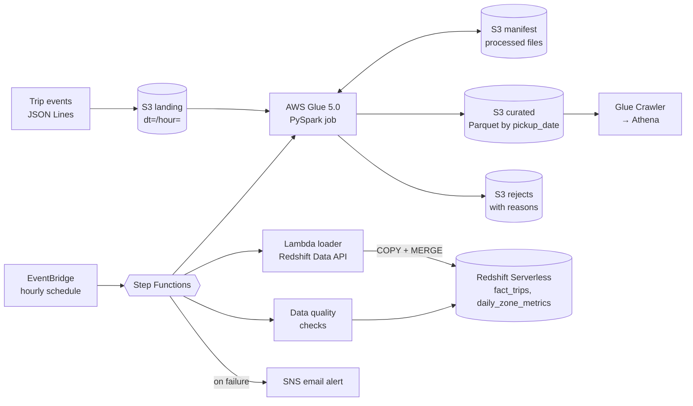

# AWS Glue + Redshift Ride-Share Pipeline


A serverless batch pipeline on **AWS** for ride-share trip data. JSON files land in **S3**, an **AWS Glue** (PySpark) job cleans, deduplicates, validates, and enriches them into partitioned Parquet, and a **Step Functions** workflow loads the results into **Amazon Redshift Serverless** with COPY + MERGE, runs data quality checks, and alerts on failure. All infrastructure is defined in **Terraform**.

## Architecture



## How it works

1. **Incremental pickup.** A JSON manifest in S3 records which landing files (by key and ETag) have been processed. Each run picks up only new files, and a file the producer re-sends with new content is picked up again. A re-run after success finds nothing new.
2. **Transform (PySpark).** Cast string fields to proper types, keep the **latest version of each trip** (re-sent trips win by event time), and validate against seven rules. Every rejected row keeps **all** the rules it broke (for example `["negative_amount", "unknown_zone"]`), so source issues can be reported back.
3. **Enrich.** Duration, average speed, tip percentage, airport and surge flags, zone names (broadcast join), and partition columns. Impossible speeds are **flagged, not dropped**, so analysts can decide.
4. **Write idempotently.** Parquet partitioned by `pickup_date` with **dynamic partition overwrite**, so re-running a day replaces that day instead of duplicating it.
5. **Load Redshift.** COPY each new partition into a staging table, **MERGE** into the target on the business key (upsert), and truncate staging, all in one Data API transaction.
6. **Check and alert.** Post-load SQL checks (no duplicate trips, aggregate matches fact, no impossible values). Any failure in any step publishes to SNS.

## Results from a local run

3 days of generated data with realistic problems built in:

| Step | Records |
|---|---:|
| Read from landing (72 files) | 12,353 |
| Duplicates removed (re-sent trips) | 353 |
| Rejected with reasons | 237 |
| **Curated trips** | **11,763** |

Every number reconciles: the generator injected exactly 353 duplicates and 237 corrupt records, and the pipeline caught all of them.

| Reject reason | Rows |
|---|---:|
| dropoff_before_pickup | 57 |
| unknown_zone | 52 |
| missing_timestamps | 45 |
| invalid_distance | 44 |
| negative_amount | 39 |

The curated output has $271,856 in fares across 11,763 trips; airport trips (17% of rides) bring in the most revenue by zone.

## Redshift design

| Table | Distribution | Sort key | Why |
|---|---|---|---|
| `analytics.fact_trips` | `DISTKEY(driver_id)` | `pickup_date, pickup_zone_id` | Driver-level metrics stay on one node; date filters skip blocks |
| `analytics.daily_zone_metrics` | `DISTSTYLE ALL` | `pickup_date` | Small table copied to every node for fast dashboard joins |
| `staging.*` | `LIKE` target | | Truncated after each load |

Reporting views cover hourly demand by zone, daily driver earnings with rankings, and day-over-day revenue by zone (window functions).

## Infrastructure (Terraform)

S3 buckets with public access blocked, KMS encryption, and lifecycle rules · Glue 5.0 job and crawler · least-privilege IAM roles for Glue, Redshift COPY, Lambda, Step Functions, and EventBridge · Redshift Serverless with the admin password managed in Secrets Manager · Lambda loader · Step Functions state machine with retries and failure alerts · EventBridge hourly schedule · SNS email alerts.

```bash
cd infra/terraform
cp terraform.tfvars.example terraform.tfvars   # set your alert email
terraform init && terraform plan
```

## Tests (23)

- **Transforms:** type casting, latest-version dedup, each validation rule (including rows that break several), derived metrics, speed outliers, aggregates
- **Manifest (moto S3):** first run sees all files, processed files are skipped, re-sent files are reprocessed, run history is recorded
- **Redshift loader:** one COPY per partition, staging truncated before and after, MERGE keys, Data API polling and error handling, and that Parquet column order matches the COPY column list
- **End to end (moto S3 + Spark):** every landed record is accounted for, the aggregate matches the fact, a second run finds nothing new, and re-running a day doesn't double it
- **Infrastructure:** the state machine has no broken or unreachable states, every task failure alerts, template variables match Terraform, all Terraform files parse, and buckets block public access and encrypt

CI also runs `terraform init` and `terraform validate` against the AWS provider.

## Run it locally

Requires Python 3.10+ and Java 17 (for Spark).

```bash
pip install -r requirements-dev.txt
PYTHONPATH=src python -m rides_pipeline.local_runner   # generate data, run the transform, print stats
pytest
```

On Windows PowerShell, set the path first: `$env:PYTHONPATH="src"`.

The AWS parts (Glue runtime, Redshift, Step Functions) are tested with mocks and static checks. Deploying with `terraform apply` creates billable AWS resources, so this repo doesn't deploy automatically.

## Project layout

```
src/rides_pipeline/
  transforms.py        PySpark logic (parse, dedupe, validate, enrich, aggregate, run)
  manifest.py          S3 manifest for incremental, idempotent pickup
  glue_job.py          Glue entry point
  redshift_loader.py   COPY + MERGE statement builder and Data API runner
  lambda_loader.py     Lambda handler called by Step Functions
  generate_data.py     sample trip events with realistic problems
  local_runner.py      run the whole transform on a laptop
sql/redshift/          tables (dist/sort keys), reporting views, data quality checks
stepfunctions/         state machine definition
infra/terraform/       all AWS resources
tests/                 23 tests
```

## Tech

AWS Glue · PySpark · Amazon S3 · Amazon Redshift Serverless · AWS Step Functions · AWS Lambda · Amazon EventBridge · Amazon SNS · Terraform · boto3 · moto · pytest · GitHub Actions
